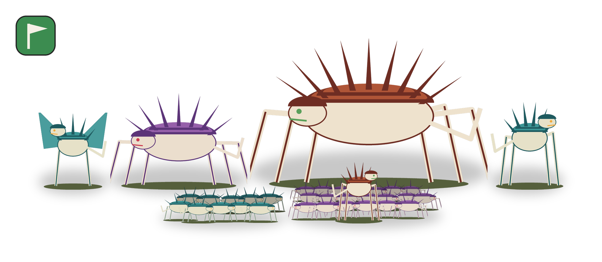

# army-photo

Turn a [New Recruit](https://www.newrecruit.eu/) army list into a **group photo of your army**:
every model in the list, lined up together like a team photo.



*Demo made with the procedurally drawn critters in `examples/demo_images`.*

## Features

- **Every model is in the picture.** A unit of 20 shows 20 models in staggered ranks.
  Back ranks are slightly smaller and darker to give some depth.
- **Leaders stand with their unit.** Attached units from the New Recruit export are
  recognised automatically. For older exports the tool asks you, or you set it in a config file.
- **True scale.** Images are drawn at their native size relative to each other, so a big
  monster stays big and an infantry model stays small.
- **Group-photo layout.** Tall units go in the back, small ones in front, with soft shadows
  on a white or transparent background.
- **Disposition icon.** The force disposition from the list is added as an icon. You can use
  single icon files, or let the tool cut them out of a reference card.
- **Works for any army.** Drop your images into `images/<faction>/` and you're done.
- **Easy to run.** Reads the list straight from the clipboard. Windows users can double-click
  `army-photo.bat`.

## Quick start

1. Install [Python 3.9+](https://www.python.org/downloads/). On Windows, tick **"Add python.exe to PATH"**.
2. Download this repository and install the one dependency:
   ```
   pip install -r requirements.txt
   ```
3. Put your model images into `images/<your faction>/` (see [Images](#images)).
4. In New Recruit, export or copy your list **as text**.
5. Run it:
   - **Windows:** double-click `army-photo.bat`
   - **Any OS:** `python army_photo.py` (clipboard) or `python army_photo.py my_list.txt`

The picture is saved as `army_photo_<list name>.png` in your image folder. On Windows it
opens automatically.

To try it without your own images:
```
python army_photo.py examples/demo_list.txt -i examples/demo_images
```

## Images

Create one folder per army inside `images/`, named like the faction line of the export,
for example `images/tyranids/` for a list that says `Tyranids`.

**File names are matched to unit names.** Case, spaces, plurals and "with …" suffixes are
ignored:

| Unit in the list               | Matching file names                                  |
|--------------------------------|------------------------------------------------------|
| `Termagants`                   | `termagant.png`, `termagants.webp`                   |
| `Tyranid Prime with Lash Whip` | `tyranid-prime.png`, `tyranid-prime-with-lash-whip.png` |
| `The Swarmlord`                | `swarmlord.png`                                      |
| `Hive Guard`                   | `hive-guard-a.png` + `hive-guard-b.png` (variants)   |

- **Variants:** suffixes like `-a`, `-b` or `-2` are mixed within a unit, so a mob of 20
  doesn't look copy-pasted. Years (`-2023`) are ignored.
- **Formats:** `.png`, `.webp` and `.jpg` work. Use images with a **transparent background**.
- **Scale:** all images of an army should share **one scale**. If an infantry model is 200 px
  tall, a model twice its size should be 400 px.

When a unit has no image, it is left out and listed in the console. Use `--placeholders` to
show a "?" for it instead.

### Images and copyright

The repository does **not** ship any miniature photos, and `images/` is git-ignored. Use photos
of your own painted models, or images you have the rights to use. Please don't commit
third-party product photos to forks.

## Configuration: `army.json`

Optional. Place it in the army's image folder (copy `images/example-army.json`):

```json
{
  "images":  { "Norn Emissary": "norn.webp", "Termagants": ["gant-1.png", "gant-2.png"] },
  "scale":   { "Neurolictor": 1.1 },
  "leaders": { "Tyranid Prime": "Hormagaunts" },
  "settings": {
    "max_model_height": 1400,
    "background": "#ffffff",
    "overlap": 110,
    "shadow_opacity": 55,
    "disposition_size": 0.16,
    "disposition_position": "top-left",
    "placeholders": false
  }
}
```

| Key        | Meaning                                                                              |
|------------|--------------------------------------------------------------------------------------|
| `images`   | Manual image mapping when a file name doesn't match a unit name.                     |
| `scale`    | Correction factor for a single unit if its image isn't quite to scale.               |
| `leaders`  | Default leader → unit pairs, used when the export has no "ATTACHED UNITS" section.   |
| `settings` | Defaults for the options below.                                                      |

## Leaders

The tool decides who leads whom in this order:

1. **New Recruit export:** if you attach a leader in New Recruit, the export contains an
   `ATTACHED UNITS` section, and that is used as-is.
2. **Presets:** `--leader "Tyranid Prime=Hormagaunts"` on the command line, or the
   `leaders` key in `army.json`.
3. **Asking you:** otherwise the tool asks for each character. Turn this off with `--no-questions`.

## Dispositions

If the list contains a force disposition (`Take and Hold`, `Disruption`, `Purge the Foe`,
`Priority Assets` or `Reconnaissance`), its icon is pasted into a corner of the picture.
The tool looks for the icon in two places:

- **Single icon files:** `images/<army>/dispositions/priority-assets.png` and so on.
- **A reference card:** a file named `dispositions.jpg` (or `dispo….png`) in the army folder.
  The five icons are cut out automatically. They must be stacked vertically in the right part
  of the image, in the order listed above.

To cut a card into single files once:
```
python army_photo.py --extract-dispositions path/to/card.jpg -i images/tyranids
```

## Command line

```
python army_photo.py [LIST] [options]

  -o, --output FILE         output file (default: army_photo_<list name>.png)
  -i, --images DIR          image folder (default: images/<faction>)
  -l, --leader "A=B"        attach character A to unit B (repeatable)
      --no-questions        never ask about leaders
      --background COLOR    "#ffffff", "#000000", "transparent", ...
      --transparent         same as --background transparent
      --max-height PX       height of the tallest model
      --placeholders        show "?" for models without an image
      --no-disposition      don't add the disposition icon
      --extract-dispositions CARD   cut a disposition card into single icons
      --no-open             don't open the picture afterwards
```

You can also install it as a command with `pip install .` and then run `army-photo`.

## Development

```
pip install -r requirements.txt pytest
pytest
python examples/make_demo_images.py   # regenerate the demo critters
```

Contributions are welcome, especially support for more list formats and smarter layouts.

## Disclaimer

This is an unofficial fan project. It is not affiliated with or endorsed by New Recruit or any
miniature manufacturer. All product names and trademarks belong to their respective owners.

## License

[MIT](LICENSE)
