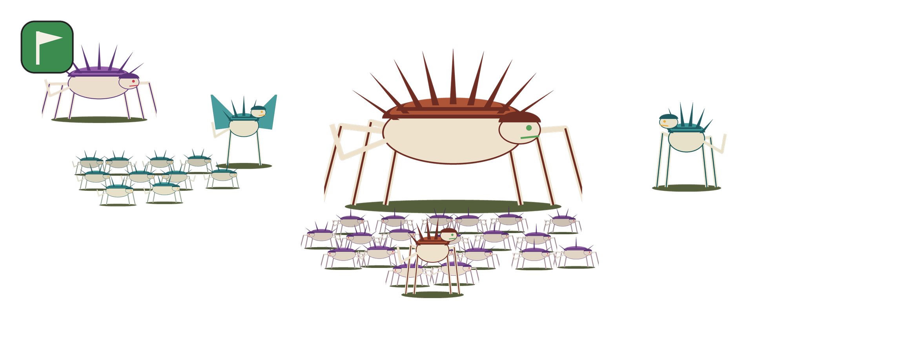
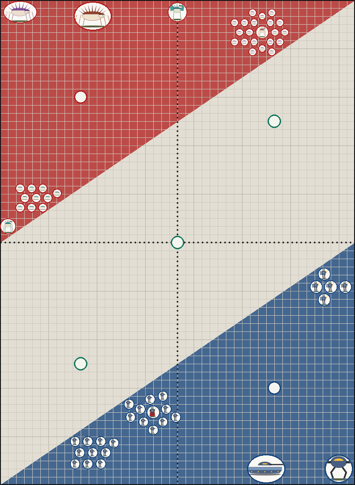

# Wargaming List Visualizer

**army-photo** turns a [New Recruit](https://www.newrecruit.eu/) army list into a **group photo of your army**:
every model in the list, lined up together like a team photo.

| Group photo | Battle-ready | Deployment board |
|:-----------:|:------------:|:----------------:|
|  |  |  |

*Demo made with two procedurally drawn armies: the critters in `examples/demo_images` and the robots
in `examples/robot_images`.*

> **Good to know**
> - **List formats:** reads all text exports of New Recruit and detects the format automatically (see [Supported list formats](#supported-list-formats)). The **GW format** gives the best result.
> - **Images:** works best with the model images from [minicompare.info](https://minicompare.info/), because they share one scale (see [Images](#images)).

## Features

- **Three looks:** a packed **group photo**, **battle-ready** with the models spread out like
  box art and one character with its unit in the middle (see [Layouts](#layouts)), or a
  **deployment board** with every model on its real base size in the deployment zone, one or two
  armies facing each other (see [Deployment board](#deployment-board)).
- **Every model is in the picture.** A unit of 20 shows 20 models in staggered ranks.
  Back ranks are slightly smaller and darker to give some depth.
- **Leaders stand with their unit.** Attached units from the New Recruit export are
  recognised automatically. For older exports the tool asks you, or you set it in a config file.
- **Picks the right image for the wargear.** With `spiky-monster-impaler.png` and
  `spiky-monster-shock.png` in the folder, each model gets the image that matches its weapons.
- **Mixes variants.** `-a`, `-b`, `-c` … images of the same model are all used, so a big unit
  doesn't look copy-pasted.
- **True scale.** Images are drawn at their native size relative to each other, so a big
  monster stays big and an infantry model stays small.
- **Clean background.** White, any colour you like, or transparent.
- **Disposition icon.** The force disposition from the list is added as an icon. You can use
  single icon files, or let the tool cut them out of a reference card.
- **Works for any army.** Drop your images into `images/<faction>/` and you're done.
- **Easy to run.** Reads the list straight from the clipboard. Windows users can double-click
  `group-photo.bat` or `battle-ready.bat`.

## Quick start

1. Install [Python 3.10+](https://www.python.org/downloads/). On Windows, tick **"Add python.exe to PATH"**.
2. Download this repository and install the one dependency:
   ```
   pip install -r requirements.txt
   ```
3. Put your model images into `images/<your faction>/` (see [Images](#images)).
4. In New Recruit, export or copy your list **as text** (any style works, GW is best).
5. Run it:
   - **Windows:** double-click `group-photo.bat` or `battle-ready.bat`
   - **Any OS:** `python army_photo.py` (clipboard) or `python army_photo.py my_list.txt`,
     add `--battle-ready` for the spread-out look

The picture is saved as `army_photo_<list name>.png` in your image folder. On Windows it
opens automatically.

To try it without your own images:
```
python army_photo.py examples/demo_list.txt -i examples/demo_images
python army_photo.py examples/demo_list.txt examples/robot_list.txt --board --map crucible-of-battle \
    -i examples/demo_images --enemy-images examples/robot_images
```

## Supported list formats

army-photo reads the text exports of [New Recruit](https://www.newrecruit.eu/). The format is
detected automatically, and the console shows which one was found.

| Format | Recognised by | Model counts | Leaders | Wargear |
|--------|---------------|:------------:|:-------:|:-------:|
| **GW** (recommended) | `Unit (75 Points)` + `•` / `◦` lists, sections in CAPS | ✅ | ✅ `ATTACHED UNITS` | ✅ per model |
| **Roster** (BattleScribe style) | `# ++ Army Roster ++`, `Unit [60 pts]:` | ✅ | ✅ `• Leading:` | ✅ per model |
| **Compact** (tournament / WTC) | `Char1: 1x Unit (210 pts): …` | ✅ | ✅ `Leading` / `Attached to` | ✅ per model |
| **Minimal** | `Unit [60 pts]` + `• 1x Model` | ✅ | ✅ `• Leading:` | – |
| **Simple** | `Unit (60pts): Upgrade` | only for led units | ✅ `+ 6x Unit` | partly |

- **No model counts:** formats without model counts (Simple) show every unit with one model.
  You can set the counts yourself with `-m "Little Monsters=20"` or the `models` key in `army.json`.
- **No leader info:** for formats without it, the tool asks you or uses your presets
  (see [Leaders](#leaders)).

A GW export looks like this:

```
My List (1,000 Points)

Monster Army
Endless Tide (3 Detachment Points)
Priority Assets
Incursion (1,000 Points)

CHARACTERS

Boss Monster (75 Points)
  • 1x Big club
...
Exported with New Recruit v37.21, Data Version: v3
```

BattleScribe files (`.ros`) and the official app are not supported yet. Pull requests are welcome.

## Layouts

| Layout | What it looks like | How to pick it |
|--------|--------------------|----------------|
| **Group photo** (default) | Units packed close together like a team photo. Tall units in the back, small ones in front. | `group-photo.bat`, `--group-photo` |
| **Battle-ready** | Models spread out like the photo on a box, seen from the front and a bit from above. One character with its unit stands in the front centre, the rest of the army stands around it in a half circle. | `battle-ready.bat`, `--battle-ready` |

**Who stands in the middle (battle-ready):**

- **Pick from a menu:** `battle-ready.bat` (or `--center ask`) lists the characters and attached
  units of your list, and you type the number.
- **By name:** `--center "Boss Monster"`. A unit name works too.
- **Random:** without `--center`, a random character is picked, preferably one that leads a unit.
  Use `--seed 3` to get the same pick again.

Battle-ready looks at the table from the front and a bit from above. The units stand in curved rows
around the hero that bend backwards at the sides like a U, and everything further back is drawn
smaller and higher up. Three settings in `army.json` change the look: `perspective` (how much
smaller things get further back, `0` = off), `tilt` (how much higher they stand) and `curve` (how
strongly the rows bend back at the sides).

Units never hide each other much: when a unit is covered by the ones in front of it, it is moved
further back (and a bit towards the middle, so the army forms a circle) until at most `max_hidden`
(default 1 %) of it is hidden.

To make one of them your default, set `"layout": "battle-ready"` in the `settings` of `army.json`.
Battle-ready pictures are saved as `army_photo_<list name>_battle_ready.png`, so they don't
overwrite the group photo.

## Deployment board

```
python army_photo.py my_list.txt --board
python army_photo.py my_list.txt opponent.txt --board --map crucible-of-battle
python army_photo.py my_list.txt opponent.txt --board --map ask --terrain ask --board-style models
```

Or on Windows: copy your list in New Recruit and double-click `board.bat`. It then asks you to
copy the opponent's list (or press Enter to deploy only your army), the map and the look.
You can also drop one or two list files and optionally a terrain layout image onto `board.bat`.

- **Battlefield:** 44" x 60", seen from above like the mission cards. The first list deploys in the
  red (attacker) zone, the second one in the blue (defender) zone.
- **Deployment maps (11th edition):** `tipping-point`, `sweeping-engagement`, `search-and-destroy`,
  `hammer-and-anvil`, `dawn-of-war`, `crucible-of-battle`, with their objective markers. You can
  add or correct maps with a `maps.json` in the image folder (same format as `MAPS` in `board.py`).
- **Real base sizes:** every model gets the base from `bases.json` in its army's image folder,
  round (`32`) or oval (`"105x70"`), in mm. Model names (`"Smart Monster": 50`) and unit names
  work. Missing ones are estimated from the image and listed in the console.
- **Two looks** (`--board-style`): `tokens` (default) shows the model inside its base, like a
  token; `models` shows just the model photos in true scale to each other, standing where their
  bases are.
- **Automatic deployment:** every unit stands together with its leaders, units keep 1" apart,
  big models go to the back of the zone, small ones to the front, spread across the zone.
- **Smart deployment on terrain:** with a terrain layout, units look for cover: infantry likes to
  stand in the ruins, and every unit prefers a spot where terrain blocks the view towards the
  enemy. Big models (60 mm bases and up) stay out of the ruins. `"smart_deploy"` in the settings
  of `army.json` sets how strong this is (`0` turns it off).
- **Terrain layouts:** put layout images into `images/layouts/` (for example the official 11th
  edition layouts from the Warhammer Event Companion; they belong to Games Workshop and are not part
  of this repository, `images/` is git-ignored). `board.bat` asks for the deployment map; only maps with a
  layout are offered. If there are several layouts for that map, it lets you pick one. The map of every image is recognised
  automatically and cached in `images/layouts/index.json`. On the command line: `--terrain ask`,
  `--terrain random`, `--terrain 43` (number of the file) or `--terrain my_layout.png`.

Start from `images/example-bases.json`: copy it into your army folder, rename it to `bases.json`
and replace the examples. Use the unit or model names from your list (case, "The" and plural -s
don't matter); round bases are a number in mm, oval ones `"long x short"`.

`bases.json` example:

```json
{
  "Little Monster": 25,
  "Boss Monster": 40,
  "Spiky Monster": "105x70"
}
```

## Images

Create one folder per army inside `images/`, named like the faction line of the export,
for example `images/monster-army/` for a list that says `Monster Army`.

**File names are matched to unit names.** Every word of the unit name has to appear in the file
name. Case, spaces, plurals, years and "with …" suffixes are ignored:

| Unit in the list               | Matching file names                                  |
|--------------------------------|------------------------------------------------------|
| `Little Monsters`              | `little-monster.png`, `little-monsters.webp`         |
| `Boss Monster with Big Club`   | `boss-monster.png`, `boss-monster-with-big-club.png` |
| `The Big Monster`              | `big-monster.png`                                    |
| `Spiky Monsters`               | `spiky-monster-a.png` + `spiky-monster-b.png` (variants) |
| `Winged Big Monster`           | `big-monster-wings.png`                              |

- **Variants:** suffixes like `-a`, `-b` or `-2` are mixed within a unit, so a mob of 20
  doesn't look copy-pasted. Years (`-2023`) are ignored.
- **Wargear:** extra words in the file name are compared with the wargear and model names from
  the list. With `spiky-monster-impaler.png` and `spiky-monster-shock.png`, a model with an
  "Impaler cannon" gets the first image and one with a "Shockcannon" the second. If a unit
  has both, each model gets its own. If no image matches the wargear, all of them are mixed.
- **Other kits:** when there is a plain `big-monster.png`, files with extra words that don't
  match anything (like `big-monster-old-edition.png`) are only used as a fallback.
- **Formats:** `.png`, `.webp` and `.jpg` work. Use images with a **transparent background**.
- **Scale:** all images of an army should share **one scale**. If an infantry model is 200 px
  tall, a model twice its size should be 400 px.
- **Recommended source:** the cut-out model images on [minicompare.info](https://minicompare.info/)
  are all drawn to the same scale, so the tool works best with them. Please respect the rights
  of the image owners and keep such images out of the repository.

When a unit has no image, it is left out and listed in the console. Use `--placeholders` to
show a "?" for it instead.

### Images and copyright

The repository does **not** ship any miniature photos, and `images/` is git-ignored. Use photos
of your own painted models, or images you have the rights to use. Please don't commit
third-party product photos to forks.

## Configuration: `army.json`

Optional. Place it in the army's image folder (copy `images/example-army.json`):

```json
{
  "images":  { "Big Monster": "big.png", "Little Monsters": ["little-1.png", "little-2.png"] },
  "models":  { "Little Monsters": 20 },
  "scale":   { "Flying Monster": 1.1 },
  "leaders": { "Boss Monster": "Little Monsters" },
  "settings": {
    "max_model_height": 1400,
    "background": "#ffffff",
    "overlap": 110,
    "shadow_opacity": 0,
    "disposition_size": 0.16,
    "disposition_position": "top-left",
    "placeholders": false,
    "layout": "group-photo",
    "perspective": 0.18,
    "tilt": 0.65,
    "curve": 0.15,
    "max_hidden": 0.01
  }
}
```

| Key        | Meaning                                                                              |
|------------|--------------------------------------------------------------------------------------|
| `images`   | Manual image mapping when a file name doesn't match a unit name.                     |
| `models`   | Model counts for formats that don't contain them (Simple format).                    |
| `scale`    | Correction factor for a single unit if its image isn't quite to scale.               |
| `leaders`  | Default leader → unit pairs, used when the export has no "ATTACHED UNITS" section.   |
| `settings` | Look and defaults: background, layout, perspective and so on (see above and below). |

## Leaders

The tool decides who leads whom in this order:

1. **The list itself:** if you attach a leader in New Recruit, the export says so
   (`ATTACHED UNITS` in GW, `Leading Genestealers[1]` in Compact, `• Leading:` in
   Minimal/Roster, `+ 6x Unit` in Simple), and that is
   used as-is.
2. **Presets:** `--leader "Boss Monster=Little Monsters"` on the command line, or the
   `leaders` key in `army.json`.
3. **Asking you:** otherwise the tool asks for each character. Turn this off with `--no-questions`.

## Dispositions

If the list contains a force disposition (`Take and Hold`, `Disruption`, `Purge the Foe`,
`Priority Assets` or `Reconnaissance`), its icon is pasted into a corner of the picture.
The tool looks for the icon in two places:

- **Single icon files:** `images/<army>/dispositions/priority-assets.png` and so on.
- **A reference card:** a file named `dispositions.jpg` (or `dispo….png`) in the army folder.
  The five icons are cut out automatically. They must be stacked vertically in the right part
  of the image, in the order listed above.

To cut a card into single files once:
```
python army_photo.py --extract-dispositions path/to/card.jpg -i images/monster-army
```

## Command line

```
python army_photo.py [LIST] [LIST2] [options]

  -o, --output FILE         output file (default: army_photo_<list name>.png)
  -i, --images DIR          image folder (default: images/<faction>)
  -l, --leader "A=B"        attach character A to unit B (repeatable)
  -m, --models "UNIT=N"     set the number of models of a unit (repeatable)
      --no-questions        never ask about leaders
      --background COLOR    "#ffffff", "#000000", "transparent", ...
      --transparent         same as --background transparent
      --max-height PX       height of the tallest model
      --placeholders        show "?" for models without an image
      --no-disposition      don't add the disposition icon
      --group-photo         packed group photo (default)
      --battle-ready        spread out like box art, a character in the middle
      --center UNIT         battle-ready: who stands in the middle; "ask" shows a menu
                            (default: random character)
      --seed N              battle-ready: repeat the same random pick
      --board               deployment board (one or two lists)
      --map NAME            board: deployment map, "ask" for a menu, "auto" with --terrain
      --board-style STYLE   board: tokens (default) or models
      --terrain LAYOUT      board: ask, random, none, a number from images/layouts or an image
      --no-terrain          board: plain battlefield without terrain
      --bases FILE          board: extra bases.json
      --enemy-images DIR    board: image folder of the second army
      --ppi N               board: pixels per inch (default 30)
      --extract-dispositions CARD   cut a disposition card into single icons
      --no-open             don't open the picture afterwards
```

You can also install it as a command with `pip install .` and then run `army-photo`.

## Development

```
pip install -r requirements.txt pytest
pytest
python examples/make_demo_images.py   # regenerate the demo critters
python examples/make_robot_images.py  # regenerate the demo robots
```

Contributions are welcome, especially support for more list formats and smarter layouts.
See [CHANGELOG.md](CHANGELOG.md) for what changed between versions.

## Disclaimer

This is an unofficial fan project. It is not affiliated with or endorsed by New Recruit or any
miniature manufacturer. All product names and trademarks belong to their respective owners.

## License

[MIT](LICENSE)
